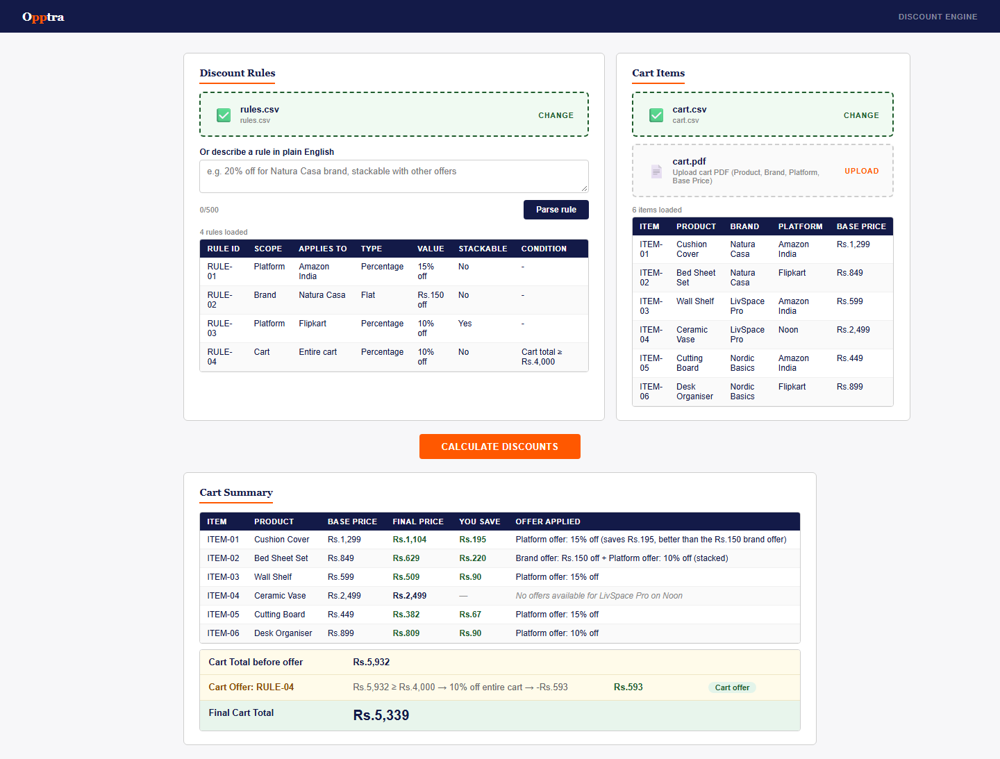
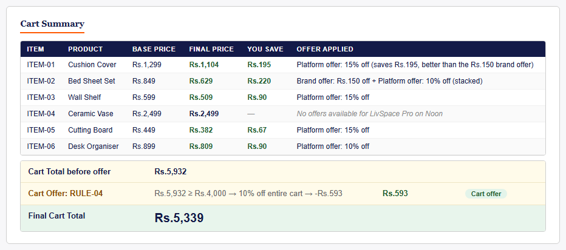
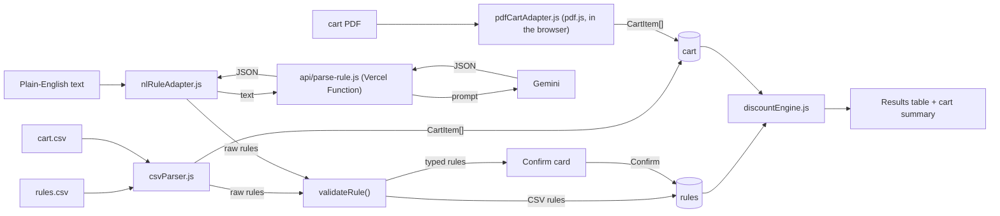
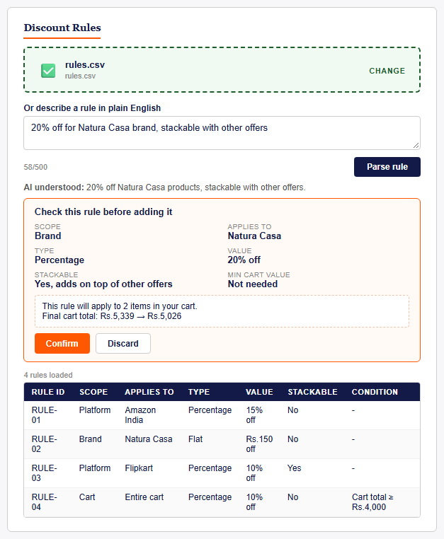
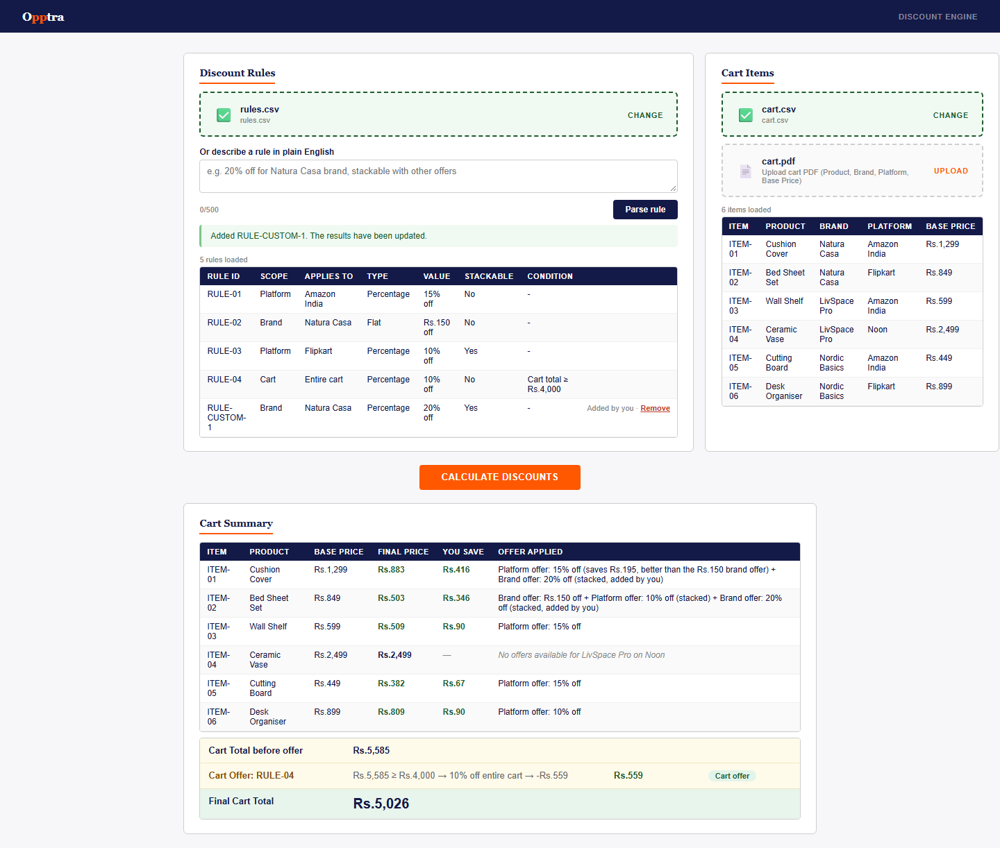
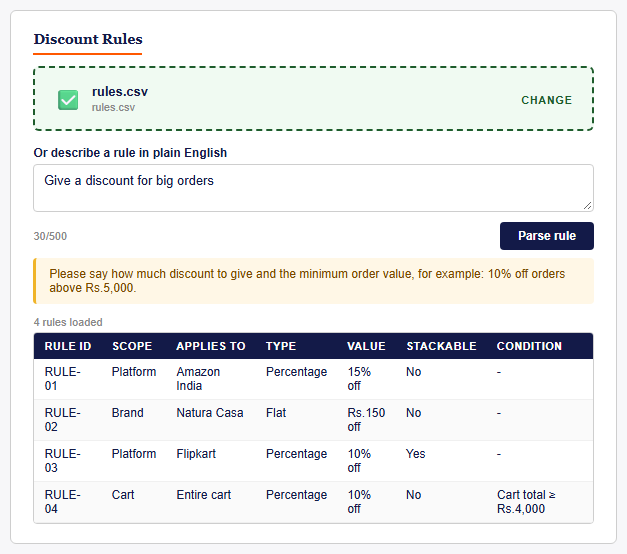
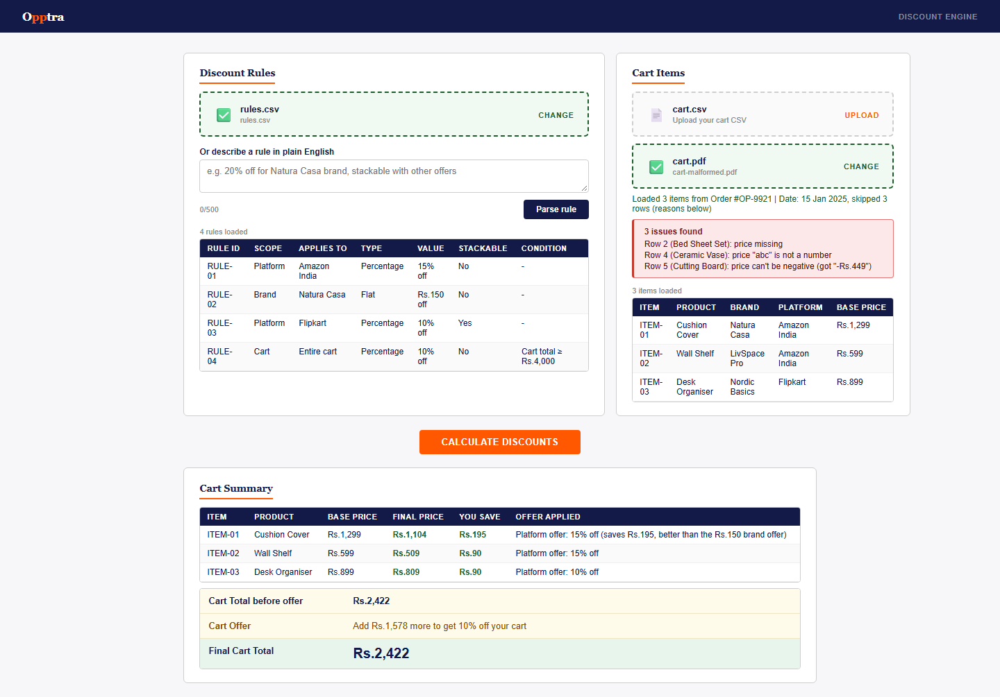

# Opptra Discount Engine: FDE Intern Take-Home

**Live demo:** https://discount-engine-assignment-ashy.vercel.app

**Loom walkthrough (recorded on the live site):** https://www.loom.com/share/40afc368c57043e68080315f82550c83

**Base repo:** https://github.com/opptra/discount-engine-assignment

A customer-facing cart pricing engine. For every cart item it picks the offer that saves the customer the most, stacks stackable offers, applies a cart-level offer after item discounts, and explains the result in plain words.

Rules can come from a CSV file or be typed in plain English (parsed by an LLM). The cart can come from a CSV or a PDF. Every input has its own adapter, every rule passes one validator, and the discount engine never knows where its data came from.



---

## Contents

- [Try it in 2 minutes](#try-it-in-2-minutes)
- [Run locally in 3 steps](#run-locally-in-3-steps)
- [How each evaluation criterion is met](#how-each-evaluation-criterion-is-met)
- [What's built](#whats-built)
- [Architecture](#architecture)
- [How to add a third input mode](#how-to-add-a-third-input-mode)
- [Task 1: cart-level offer](#task-1-cart-level-offer)
- [Task 2: plain-English rules with an LLM](#task-2-plain-english-rules-with-an-llm)
- [Task 3: PDF cart upload](#task-3-pdf-cart-upload)
- [Customer-facing text](#customer-facing-text)
- [Decisions and tradeoffs](#decisions-and-tradeoffs)
- [Where I disagree with the brief](#where-i-disagree-with-the-brief)
- [Testing](#testing)
- [Known limitations and next steps](#known-limitations-and-next-steps)
- [Project structure](#project-structure)
- [AI tools used](#ai-tools-used)

---

## Try it in 2 minutes

On the [live site](https://discount-engine-assignment-ashy.vercel.app), using the files in [`sample-data/`](sample-data):

1. Upload `rules.csv` and `cart.csv`, then click **Calculate Discounts**. You get **Rs.5,339**, the same as the brief.
2. In **"Or describe a rule in plain English"**, try the brief's examples:

   | Type this | You should see |
   |---|---|
   | `20% off for Natura Casa brand, stackable with other offers` | Card: Brand · Natura Casa · Percentage · 20% off · Stackable: Yes |
   | `Rs.100 flat discount on all Flipkart items` | Card: Platform · Flipkart · Flat amount · Rs.100 off · Stackable: No |
   | `10% off if cart value is more than Rs.5,000` | Card: Whole cart · Percentage · 10% off · Min cart value Rs.5,000 |
   | `Give a discount for big orders` | No card. A message asking for the amount and the minimum order value. |

   Click **Confirm** on a card and the results update on their own. **Remove** in the rules table undoes it.
3. Upload `cart.pdf`. The same 6 items load and the total is Rs.5,339 again, without clicking anything.
4. Upload `cart-malformed.pdf`. 3 items load, the 3 bad rows are listed with reasons, and because the cart is now Rs.2,422 the cart offer row disappears and a hint shows *"Add Rs.1,578 more to get 10% off your cart"*.

> The free Gemini tier is sometimes busy. The server then tries a second free model. If both are busy, the app says so; press **Parse rule** again.

---

## Run locally in 3 steps

Needs Node.js 20 or newer.

```bash
npm install
cp .env.example .env      # then put your key in .env: GEMINI_API_KEY=...   (Windows: copy .env.example .env)
npm run dev               # http://localhost:5173
```

- A free key comes from [Google AI Studio](https://aistudio.google.com/apikey). No credit card is needed.
- `npm run dev` also runs the serverless function locally (a small Vite plugin in `vite.config.js` calls the same `api/parse-rule.js`), so you don't need the Vercel CLI or a Vercel login.
- Without a key, everything works except the plain-English rule box, which says *"The AI parser is not set up on the server (missing API key)."*
- Tests: `npm test`. They run offline and don't need a key.

**Deployment:** Vercel builds the Vite app and turns `api/parse-rule.js` into a serverless function. `GEMINI_API_KEY` is set in Vercel → Settings → Environment Variables. Optional overrides: `GEMINI_MODEL` and `GEMINI_FALLBACK_MODEL`.

---

## How each evaluation criterion is met

| Criterion (from the brief) | What the brief asks | Where to look |
|---|---|---|
| **Correctness** | Right base results? Is a new rule parsed and applied? Does the PDF replace the cart and re-run? | [Expected results](#expected-results-verified). The confirm card adds the rule and the results recalculate ([Task 2](#task-2-plain-english-rules-with-an-llm)). `cart.pdf` replaces the cart and re-runs ([Task 3](#task-3-pdf-cart-upload)). Tests: `tests/engine.test.js`, `tests/pdfCartAdapter.test.js` ("cart.pdf gives the same 6 items as cart.csv"). |
| **LLM integration quality** | Is the parsed rule validated before use? Is the confirmation clear? Does ambiguous input give a useful error instead of crashing? | Every AI rule goes through `validateRule()`, the same gate as the CSV, **before** a card is shown. Invalid rules get an error card with no Confirm button. The confirm card shows every field in words plus a preview of the new total. Ambiguous text gets the AI's reason and an example. Tests: `tests/nlRuleAdapter.test.js`, `tests/parseRule.api.test.js`. |
| **Code clarity** | Are the two new input paths separate from the engine? Could a third input mode be added without touching the calculator? | `src/adapters/` holds the PDF and text adapters. `src/engine/` has no UI, no `fetch` and no pdf.js. [How to add a third input mode](#how-to-add-a-third-input-mode). [What changed in the engine](#what-changed-in-the-engine). |
| **Customer-facing output** | Are reasoning strings accurate after a new rule or a new cart? Does ITEM-04 give a meaningful "no offer" message? | Text is built from the rules actually applied ([Customer-facing text](#customer-facing-text)). ITEM-04: *"No offers available for LivSpace Pro on Noon"*. Test: "stays accurate after a rule is added by the user". |
| **Tradeoff judgment** | Malformed PDF row? Invalid LLM rule? Cart just below the threshold? Deliberate decisions? | [Decisions and tradeoffs](#decisions-and-tradeoffs), [Where I disagree with the brief](#where-i-disagree-with-the-brief). Tests for 3999 / 4000 / 4001, malformed PDF rows and invalid AI output. |

*The brief's criteria number the tasks differently from its task list ("Does Task 2 replace the cart"). This README uses the task list: Task 1 cart offer, Task 2 text rules, Task 3 PDF.*

---

## What's built

**Task 0: base engine, verified and deployed**
- [x] Forked, ran locally and checked against the expected results (1104 / 629 / 509 / 2499 / 382 / 809, Rs.5,339)
- [x] Deployed on Vercel at a public URL (no login wall)

**Task 1: cart-level offer**
- [x] `scope: cart` rules with a `min_cart_value` column in `rules.csv` (the brief's RULE-04 row works as printed)
- [x] Applied after all item discounts, against the sum of final item prices, condition `>=`
- [x] A separate cart offer row only when the offer applies, then the final cart total
- [x] Below the threshold: no offer row, plus a hint *"Add Rs.X more to get 10% off your cart"*

**Task 2: plain-English rules with an LLM**
- [x] Text box → serverless function → Gemini → JSON rules
- [x] Every rule validated before it is shown. Invalid rules can't be confirmed.
- [x] A confirm card per rule with the fields in plain words, a preview of affected items and the new total, and **Confirm / Discard**
- [x] Confirm adds the rule and the engine re-runs on the current cart
- [x] Ambiguous text ("Give a discount for big orders") is marked unresolvable and the user is told what is missing
- [x] Several rules in one sentence, a list of active rules, and **Remove** for rules you added
- [x] The API key never reaches the browser

**Task 3: PDF cart upload**
- [x] Upload a PDF with the columns Product, Brand, Platform, Base Price (plus the `Order #... | Date: ...` line)
- [x] Rows become `CartItem` objects and **replace** the cart. Results re-run automatically with the active rules.
- [x] Bad rows are skipped and listed with row number, product and reason. The good rows still load.
- [x] Clear messages for: not a PDF, empty, over 5 MB, password-protected, damaged, scanned image (no text), no table header, no usable rows

**Also**
- [x] One rule validator used by every rule source
- [x] Explanation text built from what was actually applied
- [x] 141 automated tests (`npm test`)
- [x] Two sample PDFs: `cart.pdf` (the brief's table) and `cart-malformed.pdf` (missing price, `abc`, negative price)

### Expected results (verified)

| Item | Base | Applied | Final | Offer text shown to the customer |
|---|---|---|---|---|
| ITEM-01 | Rs.1,299 | RULE-01 (RULE-02 skipped) | **Rs.1,104** | Platform offer: 15% off (saves Rs.195, better than the Rs.150 brand offer) |
| ITEM-02 | Rs.849 | RULE-02 + RULE-03 | **Rs.629** | Brand offer: Rs.150 off + Platform offer: 10% off (stacked) |
| ITEM-03 | Rs.599 | RULE-01 | **Rs.509** | Platform offer: 15% off |
| ITEM-04 | Rs.2,499 | none | **Rs.2,499** | No offers available for LivSpace Pro on Noon |
| ITEM-05 | Rs.449 | RULE-01 | **Rs.382** | Platform offer: 15% off |
| ITEM-06 | Rs.899 | RULE-03 | **Rs.809** | Platform offer: 10% off |
| Cart total before offer | | | **Rs.5,932** | |
| Cart offer: RULE-04 | | 5,932 ≥ 4,000 | **-Rs.593** | Rs.5,932 ≥ Rs.4,000 → 10% off entire cart → -Rs.593 |
| **Final cart total** | | | **Rs.5,339** | |



---

## Architecture



**The rules behind this layout**
1. **Adapters convert, the engine calculates.** Each input has one file that turns its format into the engine's two shapes, `DiscountRule` and `CartItem`. Adapters don't do discount maths. The engine doesn't read files, call APIs or know about the UI.
2. **One gate for rules.** CSV rows and LLM output both go through `src/engine/ruleValidation.js`. The engine only ever receives clean rules.
3. **Results are derived, not stored.** `App.jsx` keeps `rules` and `cart` in state. Results are computed from them with `useMemo`, so any new rule or new cart re-runs the engine automatically.
4. **The secret stays on the server.** Only `api/parse-rule.js` sees the Gemini key.

### The data shapes

```js
DiscountRule { ruleId, scope: 'brand' | 'platform' | 'cart', appliesTo, type: 'percentage' | 'flat',
               value, stackable, minCartValue /* cart rules only, else null */ }
CartItem     { itemId, product, brand, platform, basePrice }
```

### What changed in the engine

The brief says not to rebuild the engine for the new inputs, so `src/engine/discountEngine.js` only got additions:

| Function | Change |
|---|---|
| `ruleMatchesItem` | None. It already returns `false` for `scope: cart`, so cart rules never touch single items. |
| `calculateDiscountAmount` | None. Same rounding as the base code. |
| `applyDiscounts` | The selection logic (max saving, then stack) is unchanged. Added `Math.max(0, ...)` so a price never goes negative, and it now records what each applied rule saved, to build the explanation text. |
| `processCart`, `cartTotal` | None |
| `applyCartDiscount` | **New.** Runs after item discounts and returns `{ subtotal, cartOffer, finalTotal, nudge }`. |

When I rewrote the explanation text, I compared the old and new engine on 3,000 random carts and rule sets. Prices, applied and skipped rules, and totals were identical.

---

## How to add a third input mode

For example, an Excel cart upload or a rule picked from a dropdown:

1. **Write one adapter** in `src/adapters/` that turns the new format into `CartItem[]` or raw rule objects.
2. **Send every raw rule through `validateRule()`.** For carts, return row errors the same way the PDF adapter does.
3. **Call the existing state setter** in `App.jsx` (`setCartItems` or add to the rules).

`discountEngine.js`, `ruleValidation.js` and every other adapter stay untouched. That is how the PDF and text inputs were added.

---

## Task 1: cart-level offer

- **Data:** `rules.csv` has a `min_cart_value` column. `RULE-04,cart,,percentage,10,false,4000` loads as written in the brief, with an empty `applies_to`. Old 6-column rule files still load.
- **When it applies:** after all item discounts. The subtotal is the sum of the final item prices (Rs.5,932), and the rule applies when `subtotal >= minCartValue`.
- **Amount:** same rounding as item offers (10% of 5,932 = Rs.593). A flat cart offer can't take the total below Rs.0.
- **Several cart rules:** the one with the biggest rupee saving wins, and one cart offer row is shown.
- **Display:** *Cart total before offer* → a cart offer row **only if it applies** (`Rs.5,932 ≥ Rs.4,000 → 10% off entire cart → -Rs.593`) → *Final cart total*.
- **Below the threshold:** no offer row. A hint row shows the nearest threshold, for example *"Add Rs.1 more to get 10% off your cart"* at Rs.3,999.

---

## Task 2: plain-English rules with an LLM



### Flow

1. The user types a rule (up to 500 characters) and clicks **Parse rule** or presses Enter. Empty or too-long text is caught in the browser, without spending an AI request.
2. `nlRuleAdapter.js` sends the text **plus the brand and platform names in the current cart** to `POST /api/parse-rule`. The names help the AI tell that "Noon" is a platform and "Natura Casa" is a brand.
3. `api/parse-rule.js` calls Gemini and returns `{ status: 'ok' | 'unresolvable', rules, reason }`.
4. The adapter runs **every rule through `validateRule()`**. Valid rules get a confirm card. Invalid ones get an error card.
5. **Confirm** adds the rule as `RULE-CUSTOM-1`, `RULE-CUSTOM-2`, and so on. The results recalculate immediately. **Discard**, or editing the text, removes the card and changes nothing.
6. Rules you add are marked *"Added by you · Remove"* in the rules table. Uploading a new rules CSV keeps them.

### The confirm card

- Every field in plain words: Scope, Applies to, Type, Value, Stackable, Min cart value.
- A preview calculated by running the real engine with and without the rule:
  - *"This rule will apply to 2 items in your cart."* or *"This rule matches no items in your current cart."*
  - *"Final cart total: Rs.5,339 → Rs.5,026"*, or why the total wouldn't change (*"an existing offer already gives these items a bigger saving"*)
  - For cart rules, whether the current cart reaches the threshold, and how much more is needed
  - *"Note: this is the same as active rule RULE-CUSTOM-1."* for duplicates
- Invalid AI rules show the validator's errors (for example *"a percentage can't be more than 100, got 150"*) with only a **Dismiss** button.



### The serverless function (`api/parse-rule.js`)

| Concern | What it does |
|---|---|
| Key | Read from `process.env.GEMINI_API_KEY`, sent in a header (never in the URL), never included in errors or responses |
| Input | POST only. Text must be 1-500 characters. Cart names are cleaned and capped at 50. |
| Output format | Gemini structured output with a fixed JSON schema, so the answer is always `{ status, rules, reason }` |
| Prompt | Field definitions, conversions ("stackable / combine with other offers" → `stackable: true`, "cart value more than Rs.X" → cart rule with threshold X, "5k" → 5000), when to return `unresolvable`, *never guess a number or a name*, several rules in one sentence, and 7 examples including the brief's 4 |
| Prompt injection | The user's text is sent as a data field, and the prompt says to ignore instructions inside it. Even if the AI were fooled, the result still has to pass the validator and the user's Confirm click. |
| Time limit | 10 seconds (`AbortController`) |
| Busy model | On 429 / 500 / 503 / 504 it tries a second free model once, within the same 10 seconds |
| Privacy | `store: false`, so Google doesn't keep the interaction |
| Errors | Each becomes a readable message: busy, overloaded, too slow, key rejected, model not found, invalid response |

### What the user sees for each outcome

| Situation | Message |
|---|---|
| Ambiguous text | The AI's reason, for example *"Please say how much discount to give and the minimum order value, for example: 10% off orders above Rs.5,000."*, plus *"Try: '15% off on Amazon India items'"* if the AI gave no example |
| Gibberish | Unresolvable, with an example |
| AI returns broken JSON or the wrong shape | *"The AI returned an invalid response."* |
| AI returns an impossible rule | An error card with the validator's reasons and no Confirm button |
| No network, or no answer within 15 seconds | *"Couldn't reach the rule parser, try again."* |
| Both free models busy | *"The AI service is overloaded right now. Please try again in a moment."* |
| Empty / over 500 characters | Shown at once, and no request is sent |



---

## Task 3: PDF cart upload



**How the table is read** (`src/adapters/pdfCartAdapter.js`, all in the browser)
1. pdf.js returns each piece of text with its x/y position, for every page.
2. Pieces at the same height form a line. Words close together are joined into one cell, so "Natura Casa" stays together. Plain-text rows are split at 2+ spaces.
3. The header is the line containing Product, Brand, Platform and Price. Its cells give the column positions. Column order doesn't matter, and extra columns (like Qty) are ignored.
4. Each later line becomes a row. If it has one cell per column, cells are matched in order. Otherwise each cell goes under the nearest header, so a missing price stays missing.
5. Skipped silently: the order/date line, dividers (`────`, `----`), total lines, page footers, and a header repeated on the next page.
6. Prices are cleaned: `Rs.1,299`, `Rs. 1,299`, `₹1,299`, `INR 1,299`, `1,299/-` → 1299. Then rounded to whole rupees, like the CSV.
7. Good rows become `ITEM-01`, `ITEM-02`, ... and **replace the cart**. The results re-run without clicking Calculate.

**Edge cases**

| Case | What happens |
|---|---|
| Some rows bad | Good rows load. *"Loaded 3 items from Order #OP-9921 \| Date: 15 Jan 2025, skipped 3 rows"* plus one line per bad row, for example *"Row 4 (Ceramic Vase): price "abc" is not a number"* |
| Missing price / text price / negative price / 0 | Row skipped with that reason |
| No usable rows | The cart is emptied and every reason is shown |
| No header row | *"Couldn't find the Product / Brand / Platform / Base Price table."* |
| Scanned image (no text) | *"This PDF has no readable text. It may be a scanned image."* |
| Password-protected | *"This PDF is password-protected. Please upload an unlocked copy."* |
| Not a PDF / damaged / empty / over 5 MB | A specific message for each. The upload never crashes the page. |
| Multi-page table | All pages are read, and the repeated header is skipped |

I tested the same 6 items laid out several ways: centred and right-aligned columns, a different column order, an extra Qty column with a Total line, bold and italic words, the brief's monospace layout with a `────` divider, and a page printed with browser headers and footers. All gave Rs.5,339.

pdf.js (about 365 KB plus a 1.3 MB worker) only downloads when someone uploads a PDF, so the main page stays at about 190 KB.

---

## Customer-facing text

Every explanation is built from the rules that were **actually applied** to that item, never from fixed strings, so it stays correct after a new rule or a new cart:

| Situation | Text |
|---|---|
| One offer beat another | Platform offer: 15% off (saves Rs.195, better than the Rs.150 brand offer) |
| Equal savings | Brand offer: Rs.100 off (saves Rs.100, same saving as the platform offer) |
| Stacked offers | Brand offer: Rs.150 off + Platform offer: 10% off (stacked) |
| A rule the user typed | ... + Brand offer: 20% off (stacked, added by you) |
| A stackable rule applied on its own | Platform offer: 10% off (not "stacked": nothing to stack on) |
| Flat discount bigger than the price | Brand offer: Rs.500 off (capped so the price can't go below Rs.0) |
| No offer | No offers available for LivSpace Pro on Noon |
| Cart offer | Rs.5,932 ≥ Rs.4,000 → 10% off entire cart → -Rs.593 |
| Below the cart threshold | Add Rs.1,758 more to get 10% off your cart |

Money is shown with Indian digit grouping (Rs.1,29,999).

---

## Decisions and tradeoffs

### The cases the brief asks about

| Situation | What I did | Why | Alternative considered |
|---|---|---|---|
| **Malformed PDF row** | Skip it, list it with row number, product and reason, and load the good rows | A partial cart with a clear list of what was dropped is more useful than nothing | Reject the whole file |
| **PDF with no usable rows** | Empty the cart and show every reason | At first I kept the old cart, but the old items then looked as if they came from the new file. Emptying matches the CSV cart upload. | Keep the previous cart |
| **Invalid LLM output** | The server checks the JSON shape. The browser checks every rule with `validateRule()`. Invalid rules can't be confirmed. | LLMs can return wrong types or impossible values, and this is money | Auto-correct values |
| **Ambiguous text** | The prompt says return `unresolvable` and never guess. The UI shows what is missing and an example. | Asking is better than inventing an amount | Default values |
| **Cart just below the threshold** | No cart offer row, plus *"Add Rs.X more to get 10% off your cart"* | The brief says the row must not appear. The hint tells the customer how close they are. | Hide it silently |
| **Exactly at the threshold** | `>=`: Rs.4,000 gets the offer | The brief says "meets or exceeds" and "≥ Rs.4,000" | `>` |
| **Several cart rules** | The biggest rupee saving wins, one cart offer row | Same max-saving principle as items. The brief shows one cart row. | Stack all qualifying cart rules |
| **Where the API key lives** | Only in the Vercel Function's environment variables | Any `VITE_` variable ends up in the public JavaScript bundle | Call Gemini from the browser |
| **Rounding** | Each discount is rounded to the rupee, as in the base engine. The cart threshold uses the sum of rounded final prices. | Matches the brief's numbers (195, 629, 593) | Paise maths (more precise, but it changes the engine and the expected numbers) |
| **Flat discount bigger than the price** | The price stops at Rs.0 and the text says it was capped | A negative price makes no sense | Reject the rule |

### Other decisions

| Situation | What I did | Why |
|---|---|---|
| "10% off if cart value is **more than** Rs.5,000" | Parsed as threshold 5000, as in the brief's own expected parse. The engine's `>=` means exactly Rs.5,000 also qualifies. | One consistent threshold rule. See [the proposal](#where-i-disagree-with-the-brief). |
| The `stackable` flag on a cart rule | Cart rules always apply after item offers. One cart rule applies at most. | RULE-04 is non-stackable but still applies on top of item discounts, so the flag can't mean "with item offers" |
| Flat cart rules ("Rs.200 off orders above Rs.3,000") | Allowed, with the saving capped at the subtotal | The engine already supports flat amounts, and merchants will type them |
| Brand or platform unclear ("10% off Noon") | The cart's brand and platform names are sent with the text. If it is still unclear, the AI asks. | Avoids guessing the scope |
| An AI-returned rule id (e.g. `RULE-01`) | Ignored. The app assigns the next free `RULE-CUSTOM-N`. | An id from the AI could overwrite a CSV rule |
| Gemini overloaded (503) | One try on a second free model within the same 10 seconds | The free tier is often briefly busy, and quotas are per model |
| `temperature: 0` | Not sent. A JSON schema and examples keep answers consistent. | Current Gemini models ignore temperature |
| Numbers in the CSV | `"4,000"` → 4000. `"10%"` in the value column is rejected. | Excel adds commas. Guessing what "10%" means in a money field is unsafe. |
| CSV row without `rule_id` or `stackable` | Generated id / `false` | Friendlier than rejecting the row. The validator does the same for typed rules. |
| A new rules CSV after typing rules | The CSV rules are replaced, typed rules are kept | The user's confirmed work isn't lost |
| When results update | They are derived from rules + cart. **Calculate Discounts** still works for the brief's flow. After it, a PDF upload or a confirmed rule updates the results on its own. | The brief says the engine "re-runs automatically" |
| Where the PDF is parsed | In the browser with pdf.js 4.10.38, loaded only when needed | The brief says to add a server only if PDF parsing needs it. 4.x works on Node 20 and has the CVE-2024-4367 fix. |
| Running the API locally | A Vite plugin runs `api/parse-rule.js` inside `npm run dev` | `vercel dev` needs a Vercel login and failed on Windows (symlink permissions). This keeps local setup to 3 steps. |

---

## Where I disagree with the brief

The brief invites this ("Good reasoning for a different call beats silent compliance").

1. **"Only add a server if PDF parsing requires it."** PDF parsing doesn't need one, and it runs in the browser as asked. **The LLM call does need one:** a browser-only call has to ship the API key in the public bundle, where anyone can copy it and use up the quota. I added one stateless Vercel Function (`api/parse-rule.js`) whose only job is to hold the key and call Gemini. It does no discount maths and stores nothing. There is no database or file storage, as the brief asks.

2. **The PDF format assumption.** The parser handles the brief's table and many variations (column order, extra columns, monospace text, multi-page). Real invoices vary much more. **Proposal:** a column-mapping step. Show the first rows of an unrecognised PDF, let the user say which column is Product, Brand, Platform and Price, and remember that mapping per supplier. An LLM fallback for unknown layouts could suggest the mapping, but prices should still come from the deterministic parser and the same row checks. I didn't build this, to keep the parse predictable.

3. **The confirmation step.** I agree with it and kept it, then made it more useful: the card shows **how many cart items the rule affects and the new final total** before you confirm, warns about duplicates, and explains when a rule won't change anything. **Further proposal:** a per-item before/after list on the card for rules that change many items.

4. **"More than Rs.5,000" vs "≥ Rs.4,000".** The brief parses "more than" into the same threshold field that RULE-04 uses with `≥`, so exactly Rs.5,000 qualifies. I followed the brief. **Proposal:** store an `inclusive` flag on cart rules, so "more than" and "at least" can mean different things.

5. **`stackable` on cart rules isn't defined.** With one cart rule in the brief, the question doesn't come up. My reading: cart rules always apply after item offers, and only the best cart rule applies. **Proposal:** let stackable cart rules combine with the winning cart rule, using the same logic as items.

---

## Testing

```bash
npm test
```

**141 tests in 6 files. They run in about 3 seconds, offline, without an API key.** Gemini and `/api/parse-rule` are replaced by fake responses in the tests.

| File | Tests | What it covers |
|---|---|---|
| `tests/engine.test.js` | 31 | All 6 item prices and applied/skipped rules. 5932 → 593 → 5339. The cart offer text. 3999 (no offer, "Add Rs.1 more") / 4000 / 4001. Threshold on final prices. Several cart rules. A flat discount bigger than the price → 0. Stacking. Matching. Explanation text, including after a typed rule is added. |
| `tests/ruleValidation.test.js` | 42 | Valid rules, and rejecting a text value ("20%", "abc", "Rs.150"), 0, negative, NaN, percentage over 100, a cart rule without a threshold, a brand or platform rule without a target, unknown scope or type, unclear stackable, non-objects. Plus `"4,000"`, trimming, generated ids, and that the input isn't changed. |
| `tests/csvParser.test.js` | 7 | Sample files, the brief's `rules.csv` exactly as printed, the old 6-column format, Excel files (BOM, CRLF, capitals), and bad rows reported with row numbers |
| `tests/nlRuleAdapter.test.js` | 19 | The brief's 4 examples. What is sent. Empty or too-long text (no request). Multiple rules. Invalid AI rules rejected. AI can't pick the id. Invalid JSON, wrong shape, server messages, network error, 15-second timeout. |
| `tests/pdfCartAdapter.test.js` | 24 | A good row, a missing price, `"Rs.1,299"` and 6 other price formats, bad prices, extra spaces, plain-text rows, divider / total / note lines, no header, all rows bad, file checks (none, not PDF, empty, over 5 MB), and the **real** `cart.pdf` and `cart-malformed.pdf` |
| `tests/parseRule.api.test.js` | 18 | POST only, empty or too-long text, missing key, key in the header not the URL, JSON-only request, `unresolvable` forced to no rules, bad AI output → 502, model fallback on 503, both busy, wrong key not retried, 10-second timeout → 504, key never in errors |

---

## Known limitations and next steps

- **No rate limiting** on `/api/parse-rule`. It is protected only by the 500-character limit and the free Gemini quota. Next: a per-IP limit at the edge.
- **Gemini free tier:** sometimes busy (handled with a second model and a clear message). Google may use free-tier prompts to improve its products, so don't type confidential data.
- **English only** for plain-English rules.
- **PDFs:** no OCR for scanned PDFs. Text that wraps onto two lines inside a table cell isn't joined. Plain-text tables typed in a proportional font, where columns don't line up, may have rows reported as unreadable; they are never loaded with wrong data. One table per document is assumed.
- **Prices are whole rupees** (rounded), as in the base engine.
- **State is in memory.** A page refresh resets everything, as the brief allows.
- **Cart rules don't combine** with each other, and the hint shows only the nearest threshold.

---

## Project structure

```
api/
  parse-rule.js            Vercel Function: checks the text, calls Gemini, returns JSON. Holds the key.
src/
  engine/                  Pure logic: no UI, no fetch, no pdf.js
    discountEngine.js      Item offers (max saving + stacking), cart offer, explanation text
    ruleValidation.js      validateRule(): the one gate for every rule
    csvParser.js           CSV adapter for rules and cart (kept here, where the base repo put it)
  adapters/                Input paths that turn other formats into engine shapes
    pdfCartAdapter.js      PDF → CartItem[] (+ row errors)
    nlRuleAdapter.js       Plain English → /api/parse-rule → validated rules
  components/
    CsvUploader.jsx, DataTable.jsx, ErrorBanner.jsx    (from the base repo)
    PdfUploader.jsx        PDF upload box
    RuleTextInput.jsx      Text box, Parse button, messages
    RuleConfirmCard.jsx    Confirm / Discard card with the preview
    CartSummary.jsx        Cart total, cart offer row, final total, hint
  App.jsx                  State (rules, cart) and wiring. Results are derived with useMemo.
tests/                     141 Vitest tests
sample-data/               rules.csv (with RULE-04), cart.csv, cart.pdf, cart-malformed.pdf
docs/screenshots/          Images used in this README
vite.config.js             Vite + a small plugin that runs /api/parse-rule during npm run dev
vitest.config.js           Test settings
.env.example               GEMINI_API_KEY (and optional model overrides)
```

---

## AI tools used

I used AI tools throughout, as the brief allows. The table shows what each one did.

| Tool | What I used it for |
|---|---|
| Grok | Early research: understanding the brief, comparing approaches for PDF parsing and for keeping an LLM key secret, and picking a free LLM API |
| Claude (in [Cursor]) | Drafting and reviewing code, tests, sample PDFs and README text, step by step |
| Gemini | Not a development tool: it is the LLM inside the app that turns plain-English text into rules |

**How I worked with them**
- I wrote parts of the code myself, and **every piece of code in this repo was reviewed by me before it was used**. Nothing went in unread.
- When something wasn't right, I asked for changes and went through several rounds until it was. Only then did I add it to the project. I applied every change to the files myself, one step at a time.
- I made the design decisions and wrote them down before building: keep the engine pure, one adapter per input, one validator for every rule, the API key only on the server, PDF parsing in the browser, and no extra scope such as Excel uploads.
- After each step, I ran the app locally and on the live site, ran the tests, and checked the brief's numbers (Rs.5,339) were unchanged before committing.
- Testing caught real problems that I then fixed, for example:
  - The free Gemini model returned "503 high demand" during testing, so I added a second free model as a fallback.
  - One of my edits deleted a handler and crashed the page. A render check caught it before I pushed.
  - Discarded rule cards were using up rule ids (`RULE-CUSTOM-9`), so confirmed rules now take the next free number.
  - At first a PDF with no usable rows kept the old cart. In testing that looked as if the old items came from the new file, so I changed it to empty the cart.
- Every AI-generated rule in the app goes through the same validator as the CSV, which reflects the same rule I followed: check the AI's output before using it.


